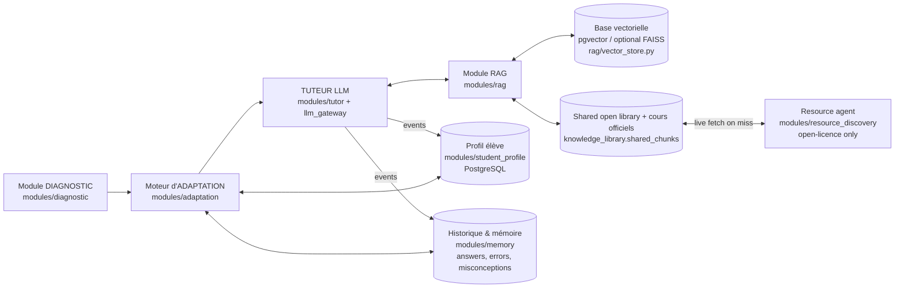
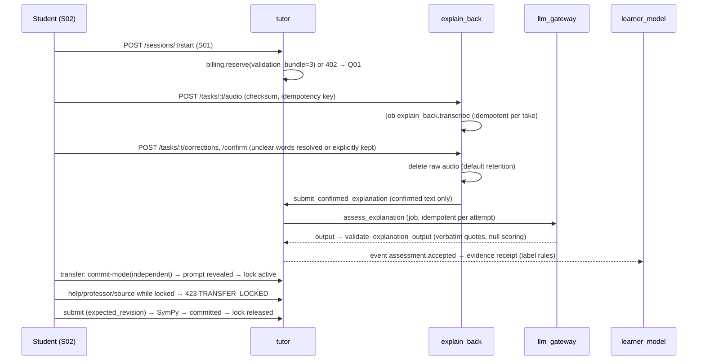
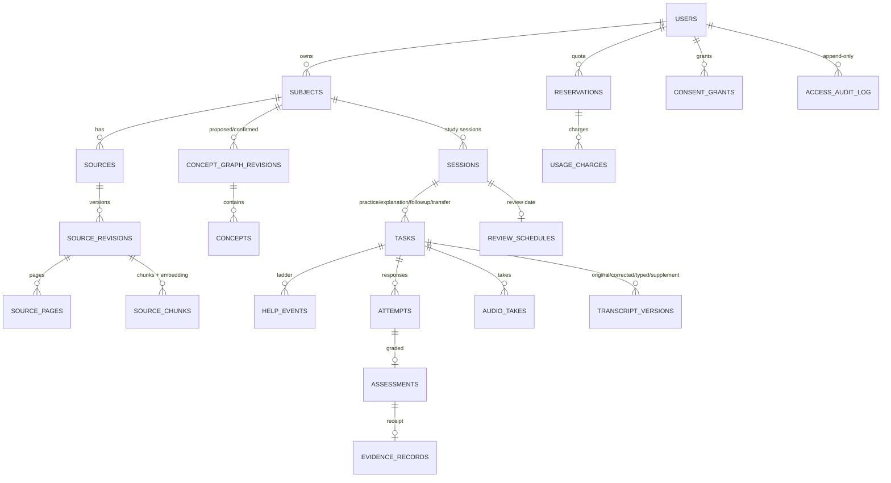

# ThinkFirst architecture (M0–M2)

Modular monolith (override §3.10): one FastAPI codebase with strict module boundaries, one Postgres database with
a schema per module, an ARQ/Redis worker running the same idempotent job handlers, and a Next.js web app that
proxies `/api/*` same-origin.

```mermaid
flowchart LR
  subgraph Browser
    W[Next.js App Router\nAtlas Studio UI\nrecorder state machine\nIndexedDB chunk recovery]
  end
  W -- "/api/* (same-origin rewrite, httpOnly cookie)" --> A
  subgraph API["FastAPI modular monolith (/api)"]
    A[routers] --> M1[identity] & M2[workspaces] & M3[ingestion] & M4[tutor] & M5[assessment] & M6[explain_back] & M7[learner_model] & M8[billing] & M9[llm_gateway]
    EV((in-process\nevent dispatcher))
    M3 -. source.confirmed .-> EV -. creates rubrics .-> M5
    M4 -. assessment.accepted / exposure .-> EV -. evidence receipts .-> M7
    M5 -. attempt.deleted .-> EV -. evidence deleted .-> M7
  end
  A -- "enqueue (arq mode)" --> R[(Redis)] --> WK[ARQ worker\nsame job handlers]
  A & WK --> PG[(Postgres 16 + pgvector\nschema per module\nRLS on private tables)]
  A & WK --> S3[(MinIO / S3\nprivate blobs)]
  M9 -- "confirmed text only" --> LLM[Gemini → Groq fallback\nor Anthropic\nor labeled demo adapter]
  M6 -- "audio only (opt-in)" --> STT[Whisper on Groq / Gemini\nor labeled demo STT]
```

## Learning architecture (team diagram → code)



| Diagram box | Package | Responsibility |
|---|---|---|
| Module DIAGNOSTIC | `modules/diagnostic` | Optional baseline (C03), misconception diagnosis after every graded answer → `misconception.detected` |
| Moteur d'adaptation | `modules/adaptation` | Next action, suggested level / side quest, adaptive review interval, memory-based nudges — every decision has a readable reason |
| Tuteur LLM | `modules/tutor` + `modules/llm_gateway` | Sessions, help ladder, Professor, concept packs; provider chain Groq → Gemini → Anthropic with circuit breaker |
| Module RAG | `modules/rag` | `hybrid()` retrieval: own course → shared library → live fetch; citations always returned |
| Profil élève (PostgreSQL) | `modules/student_profile` | Evidence receipts, labels, concept summaries, review dates (schema `learner_model`) |
| Historique & mémoire | `modules/memory` | Append-only `memory.learning_events` (RLS) fed by events; history + recurring misconceptions |
| Base vectorielle + cours officiels | `rag/vector_store.py`, `knowledge_library.shared_chunks` | pgvector per-student index (RLS) + shared open-content index; optional FAISS adapter |

### Hybrid retrieval
1. Search the student's own course chunks (private, pgvector, RLS). Relevant → answer with page citations.
2. Else search the **shared open library** (open-licence content already collected for any user).
3. Else the resource agent fetches open content live (Wikipedia, CC BY-SA) using the concept/topic name only,
   stores and indexes it once for everyone, links it privately to this subject, and the search runs again.
The library grows with use; student data never enters the shared tables.

## Modules (`api/thinkfirst/modules/*`)

| Module | Owns (schema) | Status this run | Service interface highlights |
|---|---|---|---|
| identity | `identity`: users, auth_sessions, consent_grants, access_audit_log | built | register/authenticate (scrypt), cookie sessions, preferences, `create_consent`, `revoke_consent`, `admin_access_check` (scoped + purpose + expiry + revocation, audited) |
| workspaces | `workspaces.subjects` | built | create/get/list/archive subjects, status |
| ingestion | `ingestion`: sources, source_revisions, source_pages, source_chunks (pgvector), concept_graph_revisions, concepts, source_items | built | `add_source` (validation, limits), extract job, `propose_scope` (heuristic or AI), `confirm_scope`, retry/replace/cancel/exclude (generation counter rejects late callbacks), `remove_source` (tombstone), page text, retrieval |
| tutor | `tutor`: sessions, tasks, help_events, reflections | built | sessions (revision + owner lease), stage machine, help ladder, transfer lock, conversion, follow-up/transfer jobs, Professor, S03 summary, Today |
| assessment | `assessment`: rubrics, attempts, assessments | built (no exams) | SymPy graders, explanation validator, idempotent attempts, deletion |
| explain_back | `explain_back`: audio_takes, transcript_versions | built | upload (checksum receipt), transcribe job, typed/corrected/supplement versions, confirm (audio deletion by default), delete audio now, playback, retention purge |
| learner_model | `learner_model`: evidence_records, review_schedules | basic | event subscribers → receipts, label rules, concept summaries ("based on N attempts"), review booking |
| billing | `billing`: entitlements, reservations, usage_charges | basic | mock entitlement provider, `reserve` (Q01 payload), idempotent `consume`, `release` |
| llm_gateway | `llm_gateway.llm_call_log` | built | provider routing + fallback chain, versioned prompt registry, per-owner TTL cache, metadata-only log |
| knowledge_library | `knowledge_library`: shared_resources (a), licensed_content (b), contributions | data model + guards | `can_share` (declaration + admin approval), `can_store_licensed` |
| admin | — | stub + audit foundation | uses `identity.admin_access_check` |
| planner, notifications, gamification, resource_discovery | — | documented stubs | — |

Rules: a module reads only its own tables; other modules are reached through their `service.py`; reactions are
events (`thinkfirst/core/events.py`). Events are dispatched synchronously inside the publishing transaction so a
reaction commits or rolls back with its cause; handlers are idempotent on payload IDs.

## Key flows



### Transfer lock and conversion (UC15)
- Lock = any task in the subject with `mode = independent-transfer` and non-terminal status (`policy.active_lock`).
  It lives in the database, so it holds across routes, tabs, devices, pause and reload.
- Denied while locked: `/tasks/*/help` (any task in the subject), `/professor/ask`, `/documents/*/pages/*`,
  prior feedback in task views, lesson content in session views.
- Conversion (`/tasks/:t/convert`) requires `expected_revision`, bumps the revision, and is irreversible.
  A submission carrying the pre-conversion revision is rejected (409), so a raced independent result can never be
  recorded after conversion. On Postgres the task row is locked `FOR UPDATE` while committing.

### Saves, leases and idempotency
- Session `revision` + owner lease (`/sessions/:l/lease`, 15 min, per-tab device id). Checkpoint writes need the
  lease token and the current revision, otherwise `LEASE_LOST`/`STALE_REVISION` (no last-write-wins). Take over issues
  a new lease; the old tab keeps its local draft.
- Idempotency keys: jobs (`core.jobs.idempotency_key`), attempts, help events, audio takes, evidence records,
  reservations and usage charges are all unique-keyed; retries return the original row.

## Data model (main relations)



## Privacy and isolation
- Every private table has `owner_id`; services use `get_owned()`, which returns 404 for other owners' rows.
- Postgres RLS (migration `0001_initial`): `ENABLE` + `FORCE ROW LEVEL SECURITY` with policy
  `owner_id = current_setting('app.user_id', true)` on 24 private tables. The app connects as `thinkfirst_app`
  (NOSUPERUSER, NOBYPASSRLS); migrations run as the owner. `app.user_id` is set per transaction with `set_config(..., true)`.
  Two content-free `SECURITY DEFINER` functions bootstrap the worker (`core.job_owner`, `explain_back.expired_takes`).
- `identity.access_audit_log` is append-only: UPDATE/DELETE are blocked by a trigger and revoked from the app role.
- Logging: `MetadataOnlyFormatter` whitelists IDs, route templates, status, timings and error codes. `llm_call_log`
  stores provider, model, prompt id and version, token counts, latency, cost estimate and status, never prompts or outputs.
- Uploaded and student text goes to prompts wrapped in `<course_excerpt>`/`<student_text>` tags, with an explicit
  "untrusted data" instruction.
- CSRF: SameSite=Lax cookie plus a required `x-thinkfirst-client: web` header on mutations.

## AI providers
`llm_gateway.service.provider_chain()` picks the order: `LLM_PROVIDER=auto` → Anthropic → Gemini → Groq
(each only if its key exists), then falls back along the chain on error or invalid output. With no key it uses the
**demo** adapter, and every output from it is labeled "Simulated assessment". Whatever the provider, output passes
through `validate_explanation_output`; an invalid or refused result becomes **unscored**, never zero and never demo.
SymPy performs real symbolic checks for algebra exercises and transfer.
STT: `demo` (default, labeled fixture), or `groq` (Whisper) / `gemini` (opt-in; raw audio goes to that processor,
disclosed before capture).
