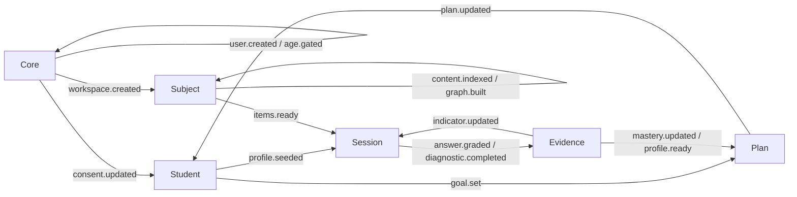

# Brains: ownership, structure and migration plan

Source: `diagnostic.md` ("ThinkFirst — Architecture up to the Diagnostic", SysBrain ownership and events).
This page maps that design onto the code, says what exists today, and lists the next structural steps.

## 1. Rules that make the code scale

1. **One owner per stage.** Each stage belongs to one *brain*. A brain publishes its own events and may only
   consume the events listed in its contract (`core/events.py` → `EVENT_CONTRACTS`).
2. **Pure domain core.** Algorithms (Elo, BKT, skill graph, adaptive diagnostic, tracking indicators, consent
   tiers) live in `thinkfirst/domain/` and import no framework, database or other package. They are tested
   offline and can run on public datasets (ASSISTments, Junyi) before real students.
3. **Application services stay thin.** `modules/`, `data/` and `platform/` load state, call `domain/`, persist
   the result and publish an event.
4. **Handover by events.** Stages never call each other's tables; any stage can be rebuilt or tested alone.
5. **Enforced, not documented.** `tests/test_architecture.py` fails when `domain/` imports a framework, or when an
   event constant or subscriber has no owner/consumers.

```
api/thinkfirst/
  domain/       pure algorithms (no I/O)              ← NEW
    mastery/      elo.py, bkt.py
    knowledge/    graph.py (skill graph, no cycles), qmatrix.py (items, Q-matrix, item-bank quality rules)
    consent/      tiers.py (4 tiers, minors gating)
    tracking/     events.py (xAPI schema), signals.py (catalog + redaction), indicators.py (rule-based)
    diagnostic/   engine.py, selection.py, inference.py, stopping.py, profile.py
  modules/      process modules: diagnostic, adaptation, tutor, rag      (application services)
  data/         stores: student_profile, memory
  platform/     identity, billing, workspaces
  core/         db, events (+ event contracts), jobs, storage, errors, logging
```

## 2. Brain ownership (from the design doc)

| Brain | Stages it owns | Workers | Implementation |
|---|---|---|---|
| **Core** | sign-up, age gate, consent, policy gate | Identity | `platform/identity` (`StudentConsent`, `apply_age_gate`, `update_tracking_consent`), `platform/workspaces`, `modules/tutor/policy.py`, `domain/consent/tiers.py` |
| **Student** | onboarding conversation, result screen | Companion voice | `platform/identity.complete_onboarding` (`profile.seeded`, `goal.set`), `modules/diagnostic.build_student_result_view`, `web/src/app/onboarding/page.tsx` |
| **Subject** | subject setup, skill graph, item bank + calibration | Content extractor, RAG, Generator, math checker | `modules/rag/*` (`content.indexed`, `graph.built`), `modules/diagnostic.ensure_knowledge_space` (`DiagnosticItemRow`, `items.ready`), `domain/knowledge/*` |
| **Evidence** | behavioral tracking, indicators, initial profile | Indicator rules, BKT, Elo | `data/memory` (`BehavioralEvent`, `BehaviorIndicator`, `ingest_tracking_event`, `indicator.updated`), `data/student_profile` (`SkillMasteryRow`, `InitialProfileRow`, `mastery.updated`, `profile.ready`), `domain/tracking/*`, `domain/mastery/*` |
| **Session** | adaptive diagnostic, tutoring sessions | Grader, diagnostician | `modules/diagnostic` (`DiagnosticSessionRow`, `start_diagnostic`, `submit_diagnostic_answer`, `stop_diagnostic`, `answer.graded`, `diagnostic.completed`), `modules/tutor`, `domain/diagnostic/*` |
| **Plan** | first plan, adaptation | Planner solver | `modules/adaptation` (`_on_profile_ready` -> `plan.updated`, frontier-aware `suggest_concept`) |

## 3. Event flow (see `EVENT_CONTRACTS`)



## 4. What this change delivered (step 1)

| Piece | Design doc section | Status |
|---|---|---|
| Event catalog + owners + consumers | "SysBrain ownership and events" | done (`core/events.py`) |
| xAPI event schema, "never tracked" rejection | "Layer 1: event schema", "What we never track" | done (`domain/tracking/events.py`) |
| Signal catalog, tier redaction | "Layer 2: signal catalog", "Consent tiers" | done (`domain/tracking/signals.py`) |
| Indicators (rapid guessing, gaming, help avoidance, wheel spinning, productive struggle, frustration, disengagement, calibration, best hours) | "Layer 3: derived indicators" | done as first rules to calibrate |
| Consent tiers, minors gating | "Consent, privacy and minors gating" | done (`domain/consent/tiers.py`); legal thresholds still an open question |
| Skill graph (acyclic), Q-matrix, item-bank quality rules | "Knowledge space" | done (`domain/knowledge`) |
| Elo + BKT | "Adaptive diagnostic engine" | done (`domain/mastery`) |
| Adaptive diagnostic: easy first item, uncertainty × importance skill choice, p(1-p) item choice, graph inference, misconception follow-up, rapid-guess weighting, "I don't know", stopping rules, closing success item | "How each step works", "Stopping rules" | done (`domain/diagnostic`) |
| Initial profile (mastery + evidence count, inferred skills, frontier, θ, expertise, misconceptions, calibration, behavior priors, data quality) | "The initial profile" | done (`domain/diagnostic/profile.py`) |
| Offline validation: simulated students, ≥ 80 % mastered/not-mastered agreement, ≤ 12 items | "Validating the diagnostic" | done as a unit test; real validation still needs public datasets and the student panel |

## 5. Next structural steps (in order)

1. **Persist knowledge space** — tables `skills`, `skill_edges`, `items` (+ misconception options, calibration counters)
   under a new `knowledge_space` schema; extractor proposes, reviewer confirms; emit `graph.built`, `items.ready`.
   Reuse `ingestion.concepts` as the bridge (a concept is a coarse skill today).
2. **Persist tracking** — `data/tracking` (append-only `tracking.events`, RLS, 12-month raw retention then
   aggregate), `POST /api/tracking/events` that runs `domain.tracking.signals.redact` against the stored consent.
3. **Consent service** — `platform/consent` stores tiers + guardian state, publishes `consent.updated`; the
   age gate publishes `age.gated`.
4. **Diagnostic service** — `modules/diagnostic/adaptive.py` rebuilds a `DiagnosticEngine` from stored answers per
   request (engine is deterministic, so no session state is needed), publishes `answer.graded` and
   `diagnostic.completed`; replaces the 3-item baseline in `service.py` (C03/UC07).
5. **Evidence → Plan** — consume `diagnostic.completed`, write mastery rows, publish `mastery.updated` and
   `profile.ready`; Plan brain turns the frontier + `goal.set` into `plan.updated`.
6. **Onboarding flow** — 10-step onboarding (`modules/onboarding`), each question with a named consumer; result screen.
7. **Folder rename (optional, last)** — group the packages by brain once the above exist, using `git mv` and
   re-export shims; Postgres schema names stay unchanged, so no data migration.

## 6. Open questions carried over

Diagnostic per subject only or also study habits; which indicators run live vs offline; diagnosing uploaded
courses with no calibrated bank; retest policy; legal age thresholds per launch country (see `diagnostic.md`).
